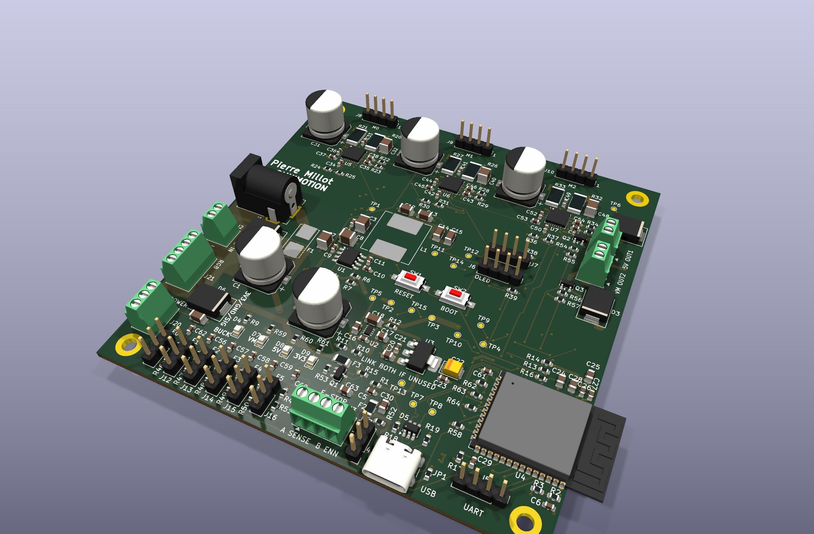

# Omnimotion

A reusable three-axis motion controller — one board and one firmware stack —
shared across a family of home projects instead of building a bespoke controller
for each one.

Rev A.1, 98 × 99 mm, four layers. Rendered from the KiCad file with
[`render_pcb.py`](hardware/scripts/render_pcb.py); a few 3D models are stand-ins,
so connector shapes are approximate. A [top view](hardware/generated/omnimotion_pcb_top.jpg)
is alongside it.

## Why

A self-playing chessboard, a zen garden and a line-art drawing machine look
nothing alike, but underneath they all want the same thing: a few stepper axes
that move accurately, know where they are, and stop when something is wrong.
Rebuilding that from scratch every time buried the interesting part of each
project under motor drivers and homing routines.

Omnimotion is that common denominator, factored out once. Standing up a new
machine should be a matter of describing its geometry, not porting a driver.

## The two halves

| Folder | What it is |
| --- | --- |
| [`hardware/`](hardware/README.md) | The board — schematic, bill of materials, and the engineering rationale behind them. Both deliverables are generated from a script, so the drawing and the parts list cannot drift apart. |
| [`software/`](software/README.md) | The firmware — motion planning, step generation, stepper-driver control, homing, fault handling, and the board API that ties them together. |

Each folder has its own README with the specifics; this page is only the map.

Concretely, the board is an ESP32-S3 driving three TMC2209 stepper drivers, with
endstops, a two-pole emergency stop, a pair of switched outputs and a small
amount of general-purpose I/O. The firmware gives you one entry point that brings
that board up, works out what is actually fitted, and hands back something you
can command.

## What it optimises for

In priority order, because these trade against each other.

1. **Fail in the safe direction.** The motor drivers stay disabled unless
   firmware and the emergency-stop loop both agree they should be on, and that
   agreement is wired in copper rather than decided in software.
2. **Buildable by one person.** Every part is hand-solderable and orderable from
   a single distributor, and the parts list is short enough to read in full.
3. **Testable without hardware.** The motion logic is kept separate from
   anything chip-specific, so it can be unit-tested on a laptop.
4. **Modular.** Drivers, sensors and displays are all optional. The firmware
   surveys what is present at startup instead of assuming a fixed machine.

## Status

The schematic, bill of materials and PCB layout are complete and consistent with
each other, and the board is fully routed. The firmware builds with runnable
examples, and the motion core is covered by host tests. But **no board has been
fabricated yet**, so none of this has been validated against copper or a running
motor. Expect Rev A.1 to need a respin.

## Scope

This is hobby equipment. The emergency stop cuts motor torque in hardware, which
is a real and deliberate design choice — but it is not a certified safety
function, it does not de-energise the output rail, and it does not brake a loaded
axis. Anything that can injure someone or destroy itself needs protection that
does not depend on this board. Both folder READMEs are explicit about where the
limits sit.

## License

The firmware in `software/` is dual-licensed under either of
[Apache License 2.0](LICENSE-APACHE) or [MIT](LICENSE-MIT), at your option.

The hardware design in `hardware/` (schematic, PCB, bill of materials and the
scripts that generate them) is licensed under the
[CERN Open Hardware Licence Version 2 – Permissive](hardware/LICENSE)
(CERN-OHL-P-2.0).

Both are provided as is, with no warranty. Building and running a board that
switches motor power is entirely at your own risk.
