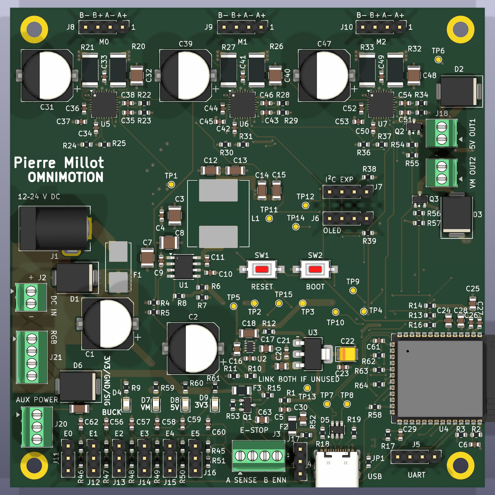

# Omnimotion hardware

Rev A.1 of the Omnimotion board: a three-axis stepper motion controller built
around an ESP32-S3 module and three TMC2209 drivers.



One board is meant to serve every project in the family, so the I/O is
deliberately generic rather than tuned to any single machine — three axes, six
endstops, two switched output channels, an analogue input, and a pair of I²C
headers for whatever a given build needs.

Simplicity is a hard design constraint here rather than an afterthought: five
IC part numbers, one FET part number, one Schottky part number, and nothing on the board
that one person cannot hand-solder and reason about without a block diagram.
[`DESIGN_NOTES.md`](DESIGN_NOTES.md) keeps the honest accounting of what that
constraint costs.

## Specifications

| | |
| --- | --- |
| MCU | ESP32-S3-WROOM-1-N16R8 — dual core, 16 MB flash, 8 MB octal PSRAM, Wi-Fi/BLE, native USB |
| Axes | 3 × TMC2209-LA-T on a shared single-wire UART bus, with StallGuard4 for sensorless homing |
| Motor current | ≤ 1.4 A RMS per axis continuous, set in firmware over UART, on 0.11 Ω 2512 shunts |
| Input | 12–24 V DC via barrel jack or screw terminal, behind a 6.3 A replaceable fuse and a TVS clamp |
| 5 V rail | 3 A buck off the motor rail, multiplexed against USB with the buck as priority; 2.5 A usable |
| 3.3 V rail | Linear regulator, ~0.5 A usable |
| Endstops | 6 direct-GPIO inputs, dry contact or 3.3 V hall sensor, with polarity and role set per connector |
| Emergency stop | 2-pole normally-closed: one pole reports to firmware, the other sits in the driver-enable return |
| Outputs | 2 discrete low-side switches, 1 A each — one on 5 V, one on the 12–24 V rail |
| Other I/O | Analogue input, I²C OLED header, I²C expansion header, addressable RGB pixel, aux power take-off |
| PCB | 4 layers, 1.6 mm FR-4, ENIG |
| Assembly | 0603 minimum, 48 BOM lines covering 174 placed parts and 15 bare test pads, sized for one stencil and a hot plate |

Fifteen test points cover every rail and every bus worth scoping. Two GPIOs are
spare, and both are strapping pins, so in practice the module is full.

## Connectors

| Ref | Part / pitch | Function |
| --- | --- | --- |
| J1 | DC-005 barrel, 5.5/2.1 mm | 12–24 V DC input |
| J2 | 2-pin screw, 2.54 mm | 12–24 V DC input, high current |
| J3 | 4-pin screw, 2.54 mm | 2-pole NC emergency stop: sense + enable return |
| J4 | USB-C 2.0 | USB data and 5 V |
| J5 | 4-pin header, 2.54 mm | Console / spare UART |
| J6 | 4-pin header, 2.54 mm | I²C OLED |
| J7 | 4-pin header, 2.54 mm | I²C expansion |
| J8–J10 | 4-pin header, 2.54 mm | Stepper motors M0–M2 |
| J11–J16 | 3-pin header, 2.54 mm | Endstops, min and max per axis |
| J17 | 3-pin header, 2.54 mm | Analogue input |
| J18 | 2-pin screw, 2.54 mm | OUT1, 5 V low-side |
| J19 | 2-pin screw, 2.54 mm | OUT2, 12–24 V low-side |
| J20 | 3-pin screw, 2.54 mm | Addressable RGB strip |
| J21 | 4-pin screw, 2.54 mm | Aux power take-off |
| SW1 / SW2 | 3 × 6 mm tactile | Reset, and the boot strap for flashing |

## What is in this folder

| Path | Contents |
| --- | --- |
| `generated/omnimotion_schematic.svg` | The schematic, 9 sheets |
| `generated/omnimotion_pcb_{top,angle}.jpg` | 3D renders of the PCB, made by `scripts/render_pcb.py` |
| `generated/omnimotion_BOM.csv` | Bill of materials as one table: a row per part, with manufacturer and Digi-Key part numbers, the KiCad footprint it needs, the sheets it appears on, and the datasheet rating that justifies it |
| `generated/omnimotion_footprints.html` | Printable parts list plus every distinct footprint the BOM needs drawn at 1:1, to lay the real parts on before the PCB is ordered. The generator also writes a PDF of it when Chrome is installed; that copy is not committed |
| `scripts/gen_schematic.py` | Generator for the schematic, and the source of truth for the design |
| `scripts/gen_bom.py` | Harvests the BOM out of the generator |
| `scripts/gen_footprint_sheet.py` | Builds the footprint sheet from the BOM and the footprints placed on the KiCad PCB |
| `scripts/render_pcb.py` | Renders the KiCad PCB to JPEG, or exports it as a STEP and GLB 3D model to paths you give, through Docker, no local KiCad needed |
| `scripts/check_kicad.py` | Compares the KiCad schematic with the generator, net by net, and the KiCad PCB with that schematic |
| `scripts/kicadlib.py` | Read-only KiCad file parsing (s-expressions, schematic connectivity, PCB pads) shared by the two scripts above |
| `scripts/schlib.py` | Minimal SVG primitive and symbol library the generator draws with |
| `DESIGN_NOTES.md` | Design rationale, datasheet verification, layout constraints, known risks |
| `kicad/` | KiCad 10 project `omnimotion`: the schematic, and the routed 4-layer PCB, 98 × 99 mm. Both follow the generated design and are checked against it by `check_kicad.py` |
| `LICENSE` | CERN-OHL-P-2.0, covering everything in this folder |

The sheets are ordered so you can read them front to back: 1 is the architecture
and power tree, 2 and 3 are input protection and the supplies, 4 is the MCU, 5–7
are one axis each, 8 is the endstops and the I²C headers, and 9 is the outputs,
test points and bring-up order. `DESIGN_NOTES.md` has the full index.

## Regenerating the deliverables

```bash
cd hardware
python3 scripts/gen_schematic.py && python3 scripts/gen_bom.py
```

No dependencies beyond a Python 3 interpreter; the generator writes SVG directly.
Add `--check` to either script to regenerate in memory and fail if the committed
file is stale.

Edit the generator, never the SVG or the CSV. Both scripts refuse to run on an
ambiguous drawing: a component terminal or wire end that touches nothing, a wire
drawn through another symbol, or a T-junction without a dot. `gen_bom.py` reads
its component list back out of the schematic generator and fails loudly on a
duplicate reference designator or a value with no BOM entry, which is what keeps
the two from disagreeing.

`python3 scripts/check_kicad.py` checks the `kicad/` project against the generator
without needing KiCad installed. It reports parts that are missing or extra,
values that differ, pins on the wrong net, design nets that KiCad shorts
together, and any part, footprint or pad net where the PCB has drifted from the
KiCad schematic. It also holds every footprint to the one the BOM names. It
exits non-zero when anything differs.

`python3 scripts/gen_footprint_sheet.py` rebuilds the footprint sheet after a BOM or PCB
change. It draws the footprint each BOM line names: from the PCB's own copy
when the PCB has it, compared pad by pad with the library (the project's
`.pretty` folder or the KiCad library downloaded into
`build/footprints/`), and from the library otherwise. References that are
missing from the PCB, or that sit on another footprint there, are flagged in
red. Capacitors show their voltage and dielectric. It prints the PDF with Google
Chrome when it is installed.

## Rendering the PCB

```bash
python3 scripts/render_pcb.py images
python3 scripts/render_pcb.py models board.step board.glb
```

`images` rewrites the two `generated/omnimotion_pcb_*.jpg` images from
`kicad/omnimotion.kicad_pcb`. `models` exports the same board as a 3D model and
needs a path for both the STEP and the GLB file. It has no default location,
because the files are several megabytes and are not kept in the repository. The
models take well under a minute, the renders a couple of minutes. The only
requirement is Docker, so KiCad does not have to be installed. The script:

1. Reads the 3D model paths out of the PCB and downloads each one, once, from
   the [official KiCad 3D library](https://gitlab.com/kicad/libraries/kicad-packages3D)
   into `build/3dmodels/` (git-ignored). The `kicad/kicad` image ships without
   3D models, which is why this step exists.
2. Pulls the `kicad/kicad:10.0` image if it is missing, and runs
   `kicad-cli pcb render` in it with the model folder mounted, once each for
   a top view and an angled perspective view.
3. Exports the board as a coloured 3D model with `kicad-cli pcb export step` and
   `export glb`: the board body, the component models and the soldermask, without
   copper pads, tracks, zones or silkscreen (the pads alone are 60% of the
   triangles). The STEP (6.8 MB) keeps solids and colours for CAD; the GLB (3.7 MB,
   about 95,000 triangles) carries PBR materials for viewers. Both are far
   heavier than a real-time scene should draw, so a consumer that animates the
   board in a browser should decimate them.
4. Copies the outputs out with `docker cp`, because a bind-mounted output folder
   is not reliably writable by the container's user. Each run names its container
   after its process id, so two runs at once do not stop each other.

The image is published for amd64 only. On Apple Silicon it runs under emulation,
and the two views take about a minute and a half together; after the first run the
models and the image are cached.

Four parts have no exact model in the KiCad library. The PCB points the Kycon
barrel jack (J1), the TMC2209 VQFN-28 (U5–U7) and the LMR33630 HTSOP-8 (U1) at
the closest library models, so their 3D shapes are approximate (the QFN model has
a 3.35 mm exposed pad against the footprint's 3.7 mm). The Littelfuse Nano2 fuse
holder (F1) has no model at all and is drawn as bare pads. Adjust the angle, zoom
or size in `VIEWS` at the top of the script.

## Building one

1. **Order.** Every orderable line carries a manufacturer part number and a
   Digi-Key link, so the board goes into a single cart. The four lines that do
   not are the PCB itself, the bare test pads, the mounting hardware and the
   optional driver heatsinks.
2. **Assemble.** Nothing is smaller than 0603 and there is exactly one FET part
   number and one Schottky part number on the board. Screw terminals, the USB-C
   hold-down and the 2.54 mm headers stay through-board on purpose: a yanked
   motor or endstop cable will lift an SMD pad. The ten signal headers snap
   off a single 40-pin breakaway strip; the motor headers are unkeyed, so mark
   pin 1 and never hot-plug a motor.
3. **Bring up in the printed order.** Sheet 9 lists it step by step — rails
   before ICs, the MCU before any driver, one driver before three. TP1–TP4 are
   the rail-by-rail power check and are worth doing before an IC goes on.
4. **Before ordering the PCB**, confirm the buck inductor footprint against the
   part you actually bought, and run DRC with your fab's real constraints.

## Limits worth knowing before you build

The full list is in [`DESIGN_NOTES.md`](DESIGN_NOTES.md); these are the ones that
change what you can safely do with the board.

- **Nothing here has been fabricated.** No claim in this folder has been checked
  against a physical board.
- **No overvoltage protection on the motor rail.** This is the headline risk.
  The TVS does not contain a large enough transient before the drivers' absolute
  maximum is exceeded; regeneration can do the same. Supply choice is the
  protection: a bench supply or a good brick on a short lead, not a long
  inductive feed or a supply shared with contactors.
- **The emergency stop cuts torque, not power.** Opening it releases the drivers
  in copper with no firmware involvement, which is the point — but the motor rail
  and the 24 V output stay live, and the motors coast rather than brake. A loaded
  vertical axis will back-drive. If something must drop mechanically, use a
  3-pole button or an external contactor.
- **Reverse polarity blows the fuse** rather than being blocked. The fuse is a
  replaceable cartridge, so the cost is a fuse — but feed the board 12–24 V and
  nothing else.
- **1.4 A RMS per axis is contingent on thermals.** The driver exposed pads are
  the entire heatsink; the thermal vias and the solid inner ground plane are not
  optional, and above ~1.2 A RMS per axis you want the adhesive heatsinks listed
  at the end of the BOM.
- **USB-only power is a 500 mA budget** enforced by a thermal PTC, not a precise
  limiter. No motors, no output loads.
- **The external inputs have no clamp diodes.** A 1 kΩ series resistor and a
  100 nF cap on each endstop and on J17 cover ESD, but nothing clamps a
  sustained wrong voltage. 24 V into a SIG pin will cost you a GPIO on a
  soldered-down module.

## Going deeper

[`DESIGN_NOTES.md`](DESIGN_NOTES.md) is the engineering record: which datasheet
was consulted for what and where one changed the plan, the emergency-stop
architecture in full, the power budget rail by rail, the pin map the firmware
depends on, the part vocabulary for home assembly, KiCad stackup and routing
constraints, and the open risks.

The firmware that drives this board is in [`../software/`](../software/README.md).
